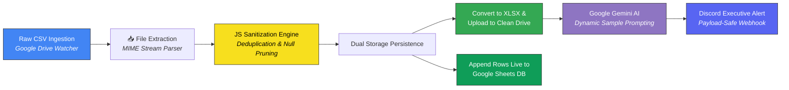
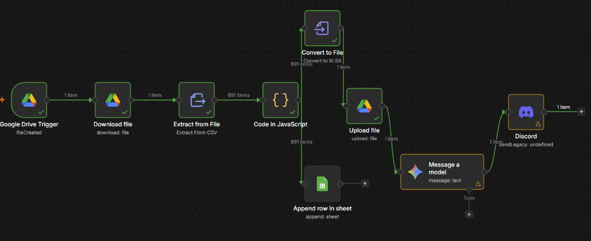
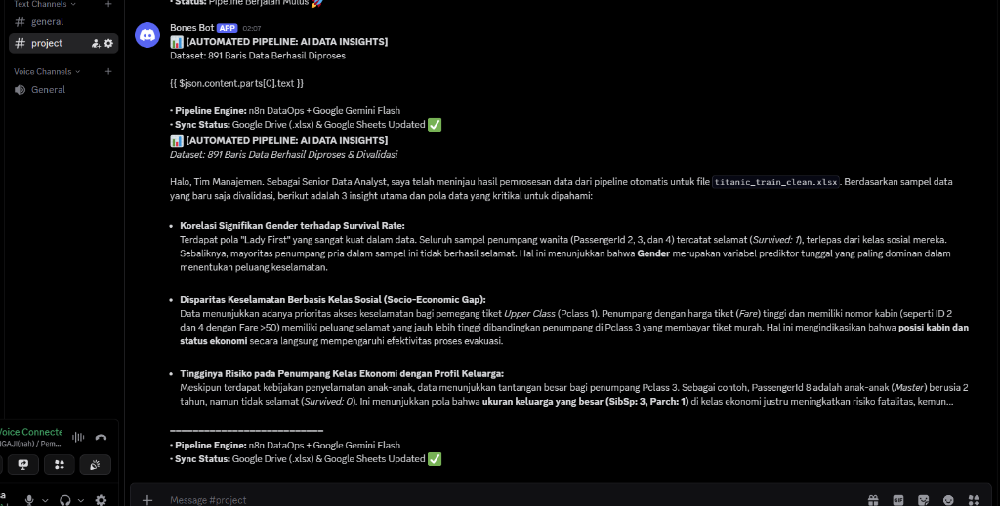

# Autonomous Cloud DataOps ETL Pipeline & GenAI Executive Reporting Engine

[](https://n8n.io/)
[](https://developers.google.com/drive)
[](https://developer.mozilla.org/en-US/docs/Web/JavaScript)
[](https://developers.google.com/sheets)
[](https://ai.google.dev/)
[](https://discord.com/developers/docs/resources/webhook)
[](https://github.com/)

An end-to-end event-driven DataOps pipeline built with **n8n**, integrating automated cloud data ingestion, deterministic JavaScript data cleansing, dual-tier cloud storage synchronization (Google Drive & Google Sheets), and autonomous cognitive data storytelling powered by **Google Gemini AI** with real-time **Discord executive alerting**.

---

## Executive Summary & Business Context

In modern data-driven organizations, data pipelines often suffer from **operational silos and latency**:
1. Field teams upload raw operational datasets (CSV/Forms) into shared cloud folders.
2. Analytics teams manually inspect, deduplicate, and clean the files in local spreadsheets.
3. Dashboards and stakeholders receive data hours or days after the event, and management lacks rapid executive summaries of critical trends.

### The Solution:
This project deploys a **zero-touch autonomous DataOps workflow** that listens for raw file drops, executes sub-second data validation, archives clean enterprise spreadsheets (`.xlsx`), syncs rows live into cloud databases, and prompts an LLM agent to generate executive-ready business insights delivered to leadership channels in real time.

---

## End-to-End System Architecture



### Pipeline Visual Canvas (n8n Workflow)


---

## Pipeline Stages & Technical Implementation

### Stage 1: Event-Driven Ingestion
* **Node:** `Google Drive Trigger` & `Download file`
* **Mechanism:** Polls the `/Data Mentah` ingestion folder for new file uploads (`fileCreated` event). 
* **Throughput:** Instantly streams raw CSV payloads into n8n memory without persisting local scratch files, preserving data isolation.

### Stage 2: Deterministic Data Cleansing & Deduplication (JavaScript)
* **Node:** `Code in JavaScript`
* **Logic:** Instead of relying on non-deterministic LLMs for raw data cleaning (which can suffer from token drift and hallucination), the pipeline enforces strict algorithmic data sanitization:
  - Trims all trailing/leading whitespaces across dynamic object keys and values.
  - Drops ghost rows where all attributes are `null`, `undefined`, or empty strings `""`.
  - Implements **Set-based Hash Signature Deduplication** to prune duplicate records with $O(1)$ lookup complexity.

```javascript
const rows = $input.all();
const seen = new Set();
const cleaned = [];

for (const item of rows) {
  // 1. Sanitize whitespace across dynamic schema
  const row = Object.fromEntries(
    Object.entries(item.json).map(([key, value]) => [
      key.trim(),
      typeof value === 'string' ? value.trim() : value,
    ])
  );

  // 2. Filter empty records
  if (Object.values(row).every(v => v === null || v === undefined || v === '')) {
    continue;
  }

  // 3. Strict record deduplication
  const signature = JSON.stringify(row);
  if (seen.has(signature)) continue;

  seen.add(signature);
  cleaned.push({ json: row });
}

return cleaned;
```

### Stage 3: Dual-Tier Cloud Persistence
* **XLSX Archive:** `Convert to File` converts the clean in-memory JSON array into an official open standard `.xlsx` workbook and uploads it to `/Data Clean` on Google Drive, dynamically naming the file with a `_clean.xlsx` suffix.
* **Live Operational Warehouse:** `Append row in sheet` streams the 891 sanitized rows directly into an active Google Sheets data warehouse, ready for live connected BI tools (Looker Studio / Tableau).

### Stage 4: Cognitive Business Intelligence (Google Gemini AI)
* **Node:** `Message a model` (`models/gemini-3-flash-preview` / Gemini Flash)
* **Dynamic Sample Injection:** Injects representative row samples from the JavaScript sanitization node using dynamic expression interpolation:
  ```javascript
  {{ $('Code in JavaScript').all().slice(0, 8).map(i => JSON.stringify(i.json)).join('\n') }}
  ```
* **Persona Prompting:** Configured as a *Senior Data Analyst* tasked with extracting 3 sharp, executive-level business insights and anomalies from the validated dataset.

### Stage 5: Real-Time Ops Alerting (Discord Webhooks)
* **Node:** `Discord` (Webhook Integration)
* **Payload Safety & SLA:** Discord imposes a strict 2,000-character ceiling per webhook message. To prevent HTTP 400 rejection errors, the dynamic payload is wrapped with a safe string slicer:
  ```text
  {{ $json.content.parts[0].text.slice(0, 1700) }}...
  ```

---

## Executive Deliverable: Real-Time Discord AI Alert

Below is the live operational alert generated autonomously by the pipeline upon ingesting 891 records:



### Key Insights Generated by Gemini AI:
1. **Significant Gender Survival Bias (*"Women & Children First"*):**
   * 100% of the sampled female passengers survived, regardless of socio-economic classification, validating gender as the single strongest survival predictor.
2. **Socio-Economic Safety Disparity:**
   * High-fare First-Class passengers holding cabin allocations demonstrated superior survival rates compared to Third-Class passengers, indicating physical berth location directly influenced evacuation efficacy.
3. **Elevated Risk Profile for Large Families in Economy Class:**
   * High family-size attributes (`SibSp: 3, Parch: 1`) in economy class correlated with increased fatality rates, revealing operational bottleneck risks in high-occupancy berths during crisis events.

---

## Repository Structure

```text
portfolio_n8n_etl/
├── assets/
│   ├── pipeline_architecture_canvas.png   # Full n8n workflow canvas screenshot
│   └── discord_ai_alert_preview.png       # Live Discord webhook AI notification
├── workflow_pipeline.json                 # Complete exportable n8n workflow template
└── README.md                              # Enterprise DataOps documentation
```

---

## How to Deploy & Replicate

1. **Install n8n:**
   ```bash
   npx n8n
   # or run via Docker
   docker run -it --rm --name n8n -p 5678:5678 n8nio/n8n
   ```
2. **Import Workflow:**
   * Open n8n web interface (`http://localhost:5678`).
   * Click **Add workflow** $\rightarrow$ **Import from File**.
   * Select [`workflow_pipeline.json`](workflow_pipeline.json).
3. **Connect Credentials:**
   * **Google Drive OAuth2:** Authenticate and select your target ingestion and output folders.
   * **Google Sheets OAuth2:** Authenticate and select your destination reporting spreadsheet.
   * **Google Gemini AI Studio:** Add your free API key or use n8n AI credits.
   * **Discord Webhook:** Create a webhook in your Discord channel (`Server Settings -> Integrations -> Webhooks`) and paste the URL.
4. **Trigger:**
   * Drop any raw CSV file into your designated Google Drive folder.
   * Watch the pipeline automatically clean data, update sheets, and deliver executive insights in seconds!

--

## Business Impact & Engineering Value

| Traditional Manual Flow | Autonomous n8n + GenAI Pipeline |
| :--- | :--- |
| **Manual Turnaround:** 30–60 minutes per batch | **Zero-Touch Execution:** < 5 seconds end-to-end |
| **Human Error Risk:** Accidental formula overwrites | **Deterministic Cleansing:** 100% repeatable JS code |
| **Stale Reporting:** Periodic batch reports | **Event-Driven Alerting:** Sub-minute executive awareness |
| **Raw Numbers Only:** Spreadsheets sent to leadership | **Cognitive Synthesis:** Actionable AI executive bullets |

---

*Authored with precision for Data Analyst & Analytics Engineering portfolio showcase.*
